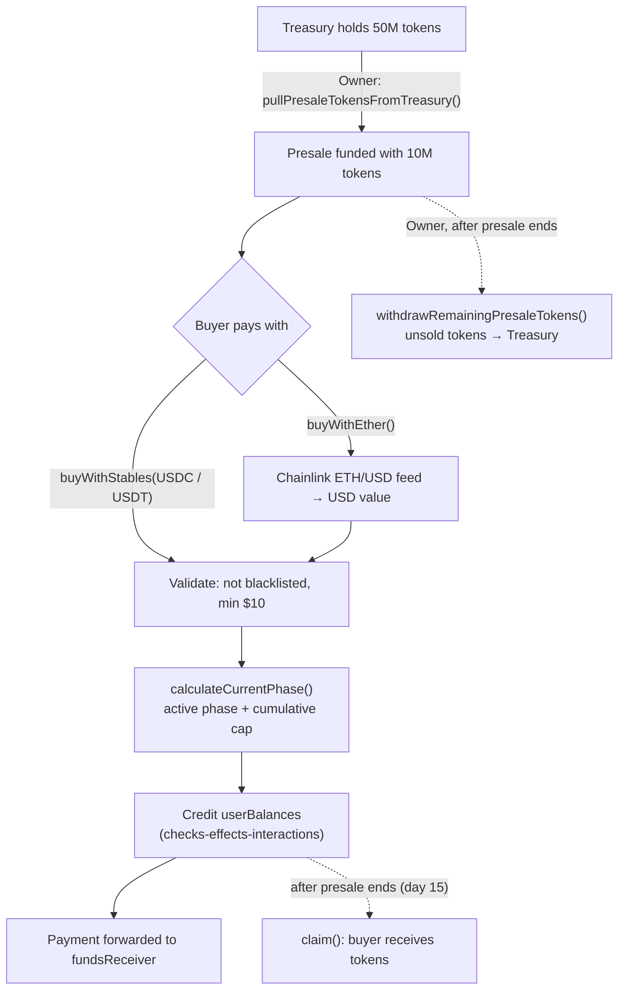

# Presale

A multi-phase token presale smart contract with increasing prices, accepting **USDC, USDT and ETH** (priced in real time through a Chainlink ETH/USD feed). Buyers accumulate their allocation during the sale and claim it all at once when the presale ends, while payments are forwarded straight to a funds receiver — the contract never holds buyer funds.

Built with [Foundry](https://book.getfoundry.sh/) and [OpenZeppelin Contracts](https://www.openzeppelin.com/contracts) (`Ownable`, `SafeERC20`, `SafeCast`), with a GitHub Actions CI pipeline running format, build and test checks on every push.

## How it works

The protocol is implemented with three main components:

1. [`Presale`](https://github.com/davidvp-dev/presale-tokens/blob/main/src/Presale.sol): the core contract. Manages the phases, purchases (stablecoins or ETH), per-user balances, claims, blacklist and admin operations.
2. [`Token`](https://github.com/davidvp-dev/presale-tokens/blob/main/src/Token.sol): the ERC-20 being sold. Mints its full 50M supply to the treasury at deployment; 10M of those are allocated to the presale.
3. [`IAggregator`](https://github.com/davidvp-dev/presale-tokens/blob/main/src/interfaces/IAggregator.sol): minimal Chainlink price feed interface used to convert ETH payments into USD.

**Presale schedule** — 10M tokens sold across three phases of increasing price, over 15 days:

| Phase | Tokens | Price | Duration |
|---|---|---|---|
| 1 | 2,000,000 | $0.005 | 5 days |
| 2 | 3,000,000 | $0.010 | 5 days |
| 3 | 5,000,000 | $0.015 | 5 days |

Tokens left unsold in a phase automatically roll over to the next one. Everyone must wait for the global presale to end (day 15) before claiming — even if all tokens sell out earlier.



Purchases follow the checks-effects-interactions pattern: the buyer's balance and `totalSold` are updated **before** any external call, and payments are routed directly to the `fundsReceiver`, so the contract never custodies user funds. Claims zero the user balance before transferring tokens, preventing double claims.

## Technical docs

1. **Buy with stablecoins** — pays with USDC or USDT; amounts are normalized across token decimals and converted at the active phase price. Enforces a $10 minimum and the phase cap. [Check function](https://github.com/davidvp-dev/presale-tokens/blob/main/src/Presale.sol#L151-L174)

```solidity
/**
 * @notice Buys presale tokens by paying with USDC or USDT.
 * @dev The buyer must have approved the payment amount, not be blacklisted,
 *      and the purchase must remain within the active phase token cap.
 *      Tokens are accumulated in the user's balance and can be claimed after the presale ends.
 * @param tokenUsedToBuy_ Address of the stablecoin used for payment: USDC or USDT.
 * @param amountToPay_ Payment amount in the stablecoin's smallest unit.
 */
function buyWithStables(address tokenUsedToBuy_, uint256 amountToPay_) external;
```

2. **Buy with ETH** — converts `msg.value` to USD using the Chainlink ETH/USD price feed, then follows the same pricing and cap logic. ETH is forwarded immediately to the funds receiver. [Check function](https://github.com/davidvp-dev/presale-tokens/blob/main/src/Presale.sol#L181-L201)

```solidity
function buyWithEther() external payable;
```

3. **Claim tokens** — available only after the full presale schedule ends; clears the balance before transferring. [Check function](https://github.com/davidvp-dev/presale-tokens/blob/main/src/Presale.sol#L208-L215)

```solidity
function claim() external;
```

4. **Phase calculation** — returns the active phase and the cumulative token cap through it, reverting if the presale hasn't started, has ended, or is sold out. [Check function](https://github.com/davidvp-dev/presale-tokens/blob/main/src/Presale.sol#L310-L324)

```solidity
/**
 * @return phaseIndex Index of the active phase, starting from zero.
 * @return accumulatedTokens Maximum cumulative number of tokens available through this phase.
 */
function calculateCurrentPhase() public view returns (uint256, uint256);
```

5. **ETH price** — reads the Chainlink feed and normalizes it to 18 decimals, rejecting non-positive prices. [Check function](https://github.com/davidvp-dev/presale-tokens/blob/main/src/Presale.sol#L331-L338)

```solidity
function getEtherPrice() public view returns (uint256);
```

6. **Admin functions** — restricted to the owner via OpenZeppelin's `Ownable`. [Check functions](https://github.com/davidvp-dev/presale-tokens/blob/main/src/Presale.sol#L223-L302)

```solidity
function pullPresaleTokensFromTreasury() external onlyOwner;   // funds the presale with the 10M allocation (one-time)
function withdrawRemainingPresaleTokens() external onlyOwner;  // returns unsold tokens to the treasury after the sale
function blacklist(address user_) external onlyOwner;
function removeBlacklist(address user_) external onlyOwner;
function updateFundsReceiver(address newFundsReceiver_) external onlyOwner;
function emergencyERC20Withdraw(address tokenAddress_, uint256 amount_) external onlyOwner; // cannot withdraw the presale token
function emergencyEthWithdraw() external onlyOwner;
```

**Deployment safeguards:** the constructor validates non-zero addresses, distinct stablecoins, strictly increasing phase prices and end times, and that phase amounts sum exactly to the 10M token cap, using custom errors for gas-efficient reverts.

## Execution example

> Pending deployment — this section will be completed once the contracts are live on a testnet/mainnet.

- Network: `<NETWORK>`
- Presale address: `<PRESALE_ADDRESS>`
- Token address: `<TOKEN_ADDRESS>`

Wallets used:

| Role | Address | Description |
|---|---|---|
| Treasury | `0x42E97F388803da3C1D19697774995724B04aFB07` | Receives the full 50M token supply at deployment and approves the 10M presale allocation. |
| Deployer / Owner / Funds receiver | `0xD5C7C9f4E570a489cD5BF3CC676B0bD020EBa40f` | Deploys the contracts, administers the presale, and receives all purchase payments. |

Execution steps:

1. The deployer deploys `Token.sol` with the treasury address. The full 50M total supply is minted automatically to the treasury: `<TX_HASH>`
2. The deployer deploys `Presale.sol`, configuring the token, treasury, funds receiver, Chainlink ETH/USD feed, start time and the three phases: `<TX_HASH>`
3. The treasury approves the `Presale` contract to spend 10M tokens (`approve(<PRESALE_ADDRESS>, 10_000_000e18)`): `<TX_HASH>`
4. The owner (deployer) calls `pullPresaleTokensFromTreasury`, which transfers the 10M tokens from the treasury into the presale and activates it: `<TX_HASH>`
5. A buyer approves the stablecoin and calls `buyWithStables` (or calls `buyWithEther`). Payment goes straight to the funds receiver: `<TX_HASH>`
6. Once the presale ends, the buyer calls `claim`: `<TX_HASH>`
7. The owner recovers any unsold tokens with `withdrawRemainingPresaleTokens`, which sends them back to the treasury: `<TX_HASH>`

## Testing

To run the tests:

```shell
forge test
```

To check coverage:

```shell
forge coverage
```

<!-- Paste your coverage table here once available -->
```
<COVERAGE_TABLE>
```

## Contract addresses

> To be completed once deployed.

| Contract | Network | Address | Explorer |
|---|---|---|---|
| `Presale.sol` | `<NETWORK>` | `<ADDRESS>` | `<EXPLORER_LINK>` |
| `Token.sol` | `<NETWORK>` | `<ADDRESS>` | `<EXPLORER_LINK>` |

## License

MIT — see the SPDX identifier in the contract source.